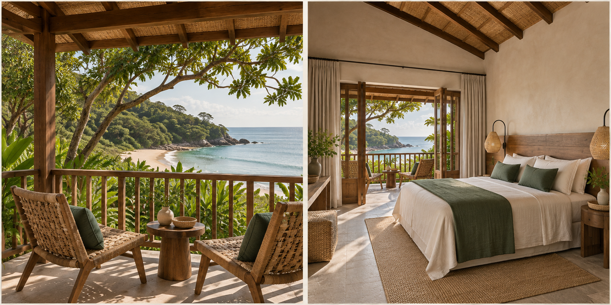

# Maison Rivage — Visual reference

## Approved master reference

User-approved visual direction: balcony and bedroom diptych, version 1.

Reference file: `assets/concepts/maison-rivage-direction-v1.png`.

This image is the visual anchor for future hotel imagery, including the hall, rooms, exterior views, events and journal illustrations depicting the property. Approval establishes the visual direction; it does not establish a complete building plan or guarantee identical geometry between generated views.

## Preserve across images

- Intimate upscale coastal boutique hotel, inspired by Madagascar.
- Warm natural timber posts, beams, doors and railings; woven ceiling panels.
- Ivory plaster walls, pale sand-colored stone floors, natural woven rugs.
- Woven lounge furniture and lamps; restrained styling.
- Off-white linen and muted deep green textile accents.
- Natural daylight, realistic materials and warm but restrained color grading.
- Tropical garden, sandy cove, rocky green headland and calm ocean where the same outlook is visible.
- Believable scale and physical arrangement; avoid introducing contradictory structures or landmarks.

## Hall — design constraints for the next view

Extend the same timber structure, woven ceiling, pale floors and ivory walls into a welcoming reception and lounge. Keep the scale appropriate for a small hotel and allow a plausible space for intimate events. These are generation constraints, not approval of a specific hall design. Do not invent a grand resort lobby or a different coastline.

## Workflow for every new hotel visual

1. Inspect the approved master image and this guide.
2. Pass the image itself to the image generation tool as a reference.
3. Describe the new scene and explicitly preserve the shared materials, architecture, palette and any visible landscape.
4. When revisiting a specific room or the hall, also include its approved image as a reference.
5. Check structural plausibility and consistency with prior approved views. Regenerate or edit visible contradictions.
6. Save a new version without overwriting approved imagery. Record its scene and approval status here.
7. Use approved visuals for publication. Keep tests identifiable as drafts until approved.

## Asset register

| Asset | Scene | Status |
|---|---|---|
| `assets/concepts/maison-rivage-direction-v1.png` | Balcony and bedroom | Approved visual direction; master reference |
| `assets/concepts/maison-rivage-hall-v1.png` | Reception, lounge and small exhibition alcove | Generated from master reference; awaiting image approval |
| `assets/concepts/maison-rivage-hall-angle-2-v1.png` | Alternate hall view from lounge | Generated using hall-v1 as reference; draft, awaiting approval. Materials and objects recognizable, but furniture placement and proportions drift; not a geometrically exact reconstruction. |
| `assets/concepts/maison-rivage-cello-evening-v1.png` | Adult cellist and small audience in rearranged lounge, view from reception side | Draft generated from hall-v1 reference; awaiting approval. Recognizable hall identity; generated perspective is not a measured reconstruction. |

The diptych is a concept reference. Generate separate compositions for final page imagery when needed.

## Room-category compositions — 2026-11-13

The user approved generating three distinct room-category visuals for chantier 8. Built-in image generation received the master reference as an actual image for every composition. All three are single continuous 1536×1024 views, not diptychs. They are saved as new assets; the master and existing live previews remain intact.

| Asset | Scene | Review |
|---|---|---|
| `assets/concepts/maison-rivage-garden-room-v1.png` | Double bedroom opening onto a ground-level garden terrace | Garden outlook, compact room, no ocean view or separate lounge; shared materials/palette consistent |
| `assets/concepts/maison-rivage-ocean-balcony-room-v1.png` | Double bedroom opening onto a balcony above the cove | Timber railing, two chairs, recognizable cove/headland; shared materials/palette consistent |
| `assets/concepts/maison-rivage-rivage-suite-v1.png` | Larger sleeping area, woven lounge seating and ocean terrace | Distinct lounge and clearer circulation; shared coastline/materials/palette consistent |

Generated and visually reviewed as coherent category proposals; integrated following the user-authorized gallery work on 2026-11-14. They are not measured architectural reconstructions. They now supply gallery hero photographs and category cards; desktop/mobile crops were reviewed. Complete prompts and built-in generation mode are recorded in `assets/concepts/room-category-generation-v1.json`.

## Room galleries — 2026-11-14

Six additional bathroom/outdoor views were generated with the master plus the respective category bedroom as actual image references. The agent reviewed materials, plausible furnishings and coherent category differentiation; the suite bathroom has a double vanity, the other ensuites a single basin, and all have walk-in showers. They were integrated as part of the user-authorized gallery implementation. See `room-gallery.md` for all nine PNG source paths, WebP serving files and media administration. Full new prompts are preserved in `assets/concepts/gallery-generation-v1.json` (built-in imagegen).
